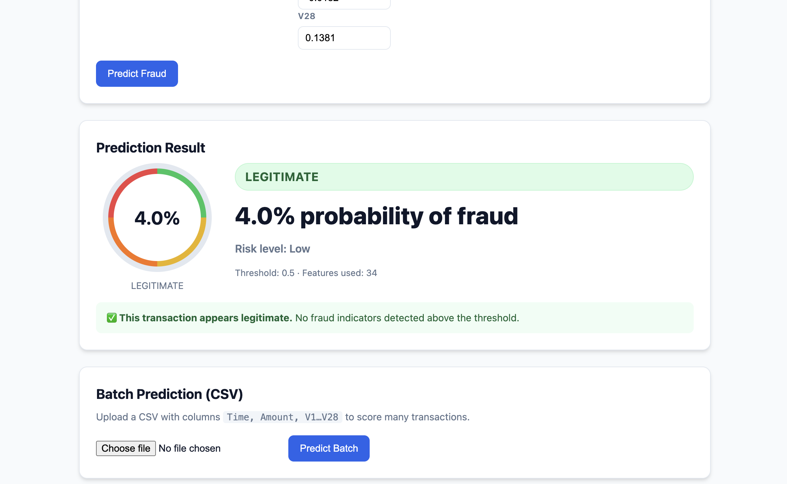

# Credit Card Fraud Detection ML System

A comprehensive machine learning system for detecting credit card fraud using batch prediction on historical transaction data.

## 📋 Overview

This project implements:
- **Data Pipeline**: Load and preprocess credit card transaction data from Kaggle dataset
- **ML Models**: Random Forest, XGBoost, and Ensemble methods with imbalance handling
- **Training Pipeline**: End-to-end training with cross-validation and hyperparameter tuning
- **Batch Prediction**: Process large transaction datasets efficiently
- **Monitoring**: Performance tracking, drift detection, and alerts

## 🏗️ Project Structure

```
fraud-detection-ml-project/
├── config/
│   └── config.yaml           # Project configuration
├── data/
│   ├── raw/               # Raw data storage
│   └── processed/         # Processed data
├── models/
│   ├── checkpoints/      # Model checkpoints
│   └── fraud_detector_model.joblib
├── pipelines/
│   ├── training_pipeline.py    # Training orchestration
│   └── prediction_pipeline.py # Batch prediction
├── reports/
│   ├── figures/          # Visualizations
│   └── metrics/         # Performance metrics
├── src/
│   ├── data/
│   │   └── loader.py       # Data loading
│   ├── features/
│   │   └── preprocessing.py  # Feature engineering
│   ├── models/
│   │   └── fraud_detector.py  # ML models
│   └── monitoring/
│       └── monitor.py        # Monitoring & alerts
├── tests/
│   └── test_fraud_detection.py
├── requirements.txt
└── README.md
```

## 🚀 Quick Start

### 1. Install Dependencies

```bash
cd fraud-detection-ml-project
pip install -r requirements.txt
```

### 2. Download Dataset

Download the Credit Card Fraud dataset from Kaggle:
- URL: https://www.kaggle.com/datasets/mlg-ulb/creditcardfraud
- Save to: `data/raw/creditcard.csv`

### 3. Train Model

```python
from pipelines.training_pipeline import run_training_pipeline

model, metrics = run_training_pipeline(
    data_path="data/raw/creditcard.csv",
    model_type="ensemble"  # or "random_forest", "xgboost"
)

print(f"F1 Score: {metrics['f1']:.4f}")
print(f"ROC-AUC: {metrics['roc_auc']:.4f}")
```

### 4. Run Batch Prediction

```python
from pipelines.prediction_pipeline import run_batch_prediction

results = run_batch_prediction(
    data_path="data/raw/creditcard.csv",
    output_path="reports/predictions.csv",
    threshold=0.5
)
```

## 📊 Key Features

### Imbalanced Data Handling
- Uses `class_weight='balanced'` for Random Forest
- Auto-calculates `scale_pos_weight` for XGBoost
- Ensemble with weighted voting

### Threshold Optimization
- Automatically finds optimal threshold for F1 score
- Supports optimization for precision/recall/business metrics

### Model Evaluation
- Standard metrics: Accuracy, Precision, Recall, F1, ROC-AUC, PR-AUC
- Business metrics: Fraud Catch Rate, False Alarm Rate

## 📈 Performance

Expected results on the Kaggle Credit Card Fraud dataset:
- ROC-AUC: > 0.95
- PR-AUC: > 0.80
- F1 Score: > 0.80
- Recall: > 0.80

## 🔧 Configuration

Edit `config/config.yaml` to customize:

```yaml
model:
  type: "ensemble"  # random_forest, xgboost, ensemble
  
training:
  n_folds: 5
  tuning:
    enabled: true
    n_trials: 20
    
evaluation:
  business_metrics:
    fraud_catch_rate: 0.8
    false_alarm_rate: 0.1
```

## ��� Testing

Run tests:
```bash
pytest tests/ -v
```

Run specific test:
```bash
pytest tests/test_fraud_detection.py::TestRandomForestFraudDetector -v
```

## 📖 Documentation

### Data Schema

| Column | Type | Description |
|--------|------|-------------|
| Time | float | Seconds since first transaction |
| V1-V28 | float | PCA-transformed features |
| Amount | float | Transaction amount |
| Class | int | 0=legitimate, 1=fraud |

### API Usage

```python
# Load and preprocess data
from src.data.loader import load_credit_card_data
from src.features.preprocessing import FraudDetectionPreprocessor

X_train, X_test, y_train, y_test = load_credit_card_data("data/raw/creditcard.csv")
preprocessor = FraudDetectionPreprocessor()
X_train_processed = preprocessor.fit_transform(X_train)

# Train model
from src.models.fraud_detector import RandomForestFraudDetector
model = RandomForestFraudDetector(n_estimators=100)
model.fit(X_train_processed, y_train)

# Predict
scores = model.predict_scores(X_test)
predictions = model.predict(X_test)

# Evaluate
metrics = model.evaluate(X_test, y_test)
```

## 📝 License

MIT License

## 🤝 Credits

Dataset: Machine Learning Group - ULB
- https://www.kaggle.com/datasets/mlg-ulb/creditcardfraud

## 🌐 API & Web Interface

A FastAPI backend and a browser frontend let you use the trained model through a web interface.

### 1. Install API dependencies
```bash
pip install -r requirements.txt
```

### 2. Start the API server
```bash
python run_api.py
# options: --host, --port, --reload, --threshold
# e.g. FRAUD_THRESHOLD=0.6 python run_api.py --reload
```
The model (`models/fraud_detector_model.joblib`) and preprocessor (`models/preprocessor.joblib`) load automatically on startup.

### 3. Open the web interface
- **UI**: http://127.0.0.1:8000/ui
- **Interactive API docs (Swagger)**: http://127.0.0.1:8000/docs
- **OpenAPI schema**: http://127.0.0.1:8000/openapi.json

### 4. API endpoints
| Method | Endpoint | Description |
|--------|----------|-------------|
| GET | `/` | API info |
| GET | `/health` | Health check (model loaded?) |
| GET | `/model-info` | Model type, features, threshold, metrics |
| POST | `/predict` | Score a single transaction (JSON body) |
| POST | `/predict/batch` | Score many transactions from an uploaded CSV |
| GET | `/predictions/{file}` | Download a batch predictions CSV |

### Example: single prediction via curl
```bash
curl -X POST http://127.0.0.1:8000/predict \
  -H "Content-Type: application/json" \
  -d '{"Time": 69808, "Amount": 540, "V1": 0.1362, ..., "V28": 0.1381}'
```
Response includes `is_fraud`, `fraud_probability`, `risk_level` (Low/Medium/High/Critical), and the `threshold` used.

### Frontend features
- Single-transaction form with all 30 inputs (Time, Amount, V1–V28)
- "Load legitimate / fraud sample" buttons for quick testing
- Adjustable decision threshold with a fraud-risk gauge
- Batch CSV upload with results table and downloadable predictions CSV

### 📸 UI Screenshots

Save screenshots to `docs/screenshots/` and reference them here:

| Screen | File | Description |
|--------|------|-------------|
| Home page | `docs/screenshots/home.png` | Landing page with API status bar and single-transaction form |
| Fraud detection result | `docs/screenshots/prediction-fraud.png` | Result card showing a fraud detection (high-risk badge + gauge) |
| Legitimate result | `docs/screenshots/prediction-legit.png` | Result card showing a legitimate transaction (low-risk badge + gauge) |
| Batch prediction | `docs/screenshots/batch.png` | Batch CSV upload with results table and download link |

#### Home page



The UI shows:
- **API status bar** — indicates whether the backend model is loaded
- **Single-transaction form** — all 30 inputs (Time, Amount, V1–V28)
- **Sample buttons** — load a legitimate or fraud sample transaction
- **Decision threshold slider** — adjustable cutoff for fraud classification
- **Prediction result card** — fraud probability %, risk gauge, risk level, threshold, and features used
- **Batch prediction (CSV)** — upload a CSV with `Time, Amount, V1…V28` columns to score many transactions at once, with a downloadable results CSV

To add your own screenshots, save them as PNG files in `docs/screenshots/` using the filenames above.

